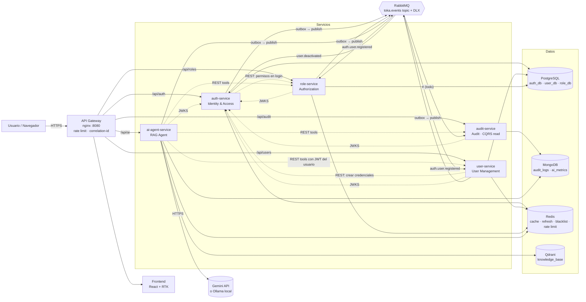

# Toka User Platform

Plataforma de gestión de usuarios basada en microservicios: autenticación distribuida con JWT RS256 y JWKS, autorización por roles y permisos, auditoría de eventos y un agente de IA con RAG que responde preguntas sobre la plataforma usando herramientas sobre los servicios.

Todo se levanta localmente con un solo `docker compose up`.

## Arquitectura

Diagrama tomado de [docs/01-arquitectura.md](docs/01-arquitectura.md):



Cinco servicios de backend con bounded contexts propios, un frontend React, un gateway nginx y su infraestructura (PostgreSQL, MongoDB, Redis, RabbitMQ, Qdrant). Cada servicio tiene su propia base de datos y se comunica por REST (síncrono) y por eventos en RabbitMQ (asíncrono, con transactional outbox).

| Servicio | Puerto | Contexto | README |
|---|---|---|---|
| auth-service | 3001 | Identidad y acceso | [services/auth-service](services/auth-service/README.md) |
| user-service | 3002 | Gestión de usuarios | [services/user-service](services/user-service/README.md) |
| role-service | 3003 | Roles y permisos | [services/role-service](services/role-service/README.md) |
| audit-service | 3004 | Auditoría (lectura CQRS) | [services/audit-service](services/audit-service/README.md) |
| ai-agent-service | 3005 | Asistente IA (RAG) | [services/ai-agent-service](services/ai-agent-service/README.md) |
| frontend | 8080 (vía gateway) | SPA React | [frontend](docs/03-frontend.md) |

## Requisitos

- **Docker** con Compose v2 (`docker compose version`).
- **Node.js 22 LTS** y npm, solo si vas a correr los tests o el frontend en modo desarrollo.
- Puertos libres: `8080` (aplicación), `15672` (consola de RabbitMQ) y `5173` (dev server del frontend, opcional).

## Configuración

Docker Compose funciona sin `.env` porque todas las variables tienen valores por defecto. Para personalizar, copia la plantilla:

```bash
cp .env.example .env
```

### Proveedor del LLM

El agente necesita un modelo de lenguaje. Elige una opción:

**Opción 1 — Gemini (recomendada, nivel gratuito).**

1. Entra a [Google AI Studio](https://aistudio.google.com/apikey) con tu cuenta de Google y crea una API key. No requiere tarjeta.
2. Pégala en `.env`:
   ```bash
   LLM_PROVIDER=gemini
   GEMINI_API_KEY=tu_clave
   ```

**Opción 2 — Sin clave: `mock`.** Respuestas deterministas, sin internet ni costo. Es lo que usan los tests.

```bash
LLM_PROVIDER=mock
```

**Opción 3 — Modelo local: `ollama`.** Sin internet después de descargar el modelo.

```bash
LLM_PROVIDER=ollama
docker compose --profile local-llm up -d
docker compose exec ollama ollama pull llama3.2:3b
```

Si `GEMINI_API_KEY` está vacío con `LLM_PROVIDER=gemini`, el agente arranca con `mock` y lo registra como advertencia en los logs.

## Levantar el sistema

```bash
docker compose up -d --build
docker compose ps        # espera a que todos los servicios estén "healthy"
```

La primera vez tarda varios minutos porque construye las imágenes; el modelo de embeddings (~118 MB con `EMBEDDING_DTYPE=q8`) ya viene dentro de la imagen del agente. Para detenerlo: `docker compose down` (añade `-v` para borrar también los datos).

## Credenciales y URLs

Usuario administrador semilla (configurable con `SEED_ADMIN_EMAIL` y `SEED_ADMIN_PASSWORD`):

| Email | Contraseña | Rol |
|---|---|---|
| `admin@toka.local` | `Admin123!` | ADMIN |

| Qué | URL |
|---|---|
| Aplicación (SPA) | http://localhost:8080 |
| API vía gateway | http://localhost:8080/api/... |
| JWKS (llaves públicas) | http://localhost:8080/api/auth/.well-known/jwks.json |
| Consola de RabbitMQ | http://localhost:15672 (usuario `toka`, contraseña `toka_dev_pwd`) |
| Frontend en desarrollo (recarga en caliente, opcional) | http://localhost:5173 (requiere el stack arriba) |

Para ver el flujo completo: entra a la SPA con el admin, crea un usuario en **Usuarios**, asigna un rol en **Roles**, revisa los eventos en **Auditoría** y pregunta algo en **Asistente**.

## Tests y coverage

Comando principal, desde la raíz del repositorio:

```bash
npm install                 # workspaces del backend
(cd frontend && npm ci)     # el frontend no es workspace: se instala aparte
npm run test:all
```

`npm run test:all` ejecuta con `CI=true` los tests de `packages/common`, de los cinco servicios y del frontend, con `--verbose` (cada test aparece con ✓) y `--coverage`. Al final imprime una tabla con el coverage de cada paquete.

Resultado de la última ejecución verificada: **499 tests pasando, 0 fallos**; coverage de statements entre 77 % (frontend, incluye componentes fuera del alcance) y 100 % (audit-service). El detalle de qué mide cada umbral está en [docs/coverage.md](docs/coverage.md).

Reporte HTML de cada paquete (se genera con `test:all`):

- `services/<servicio>/coverage/index.html`
- `packages/common/coverage/index.html`
- `frontend/coverage/index.html`

Una copia versionada de esos reportes, de los 8 paquetes (los 7 originales y mcp-server), está en [docs/coverage/](docs/coverage/).

Para un solo servicio: `npm test -w services/auth-service -- --coverage`.

**CI:** cada push o PR a `master`/`main` corre [.github/workflows/backend.yml](.github/workflows/backend.yml) (build + tests con umbral de 70 %) y [.github/workflows/frontend.yml](.github/workflows/frontend.yml) (lint, typecheck, tests y build).

## Cómo revisar el proyecto

Con el stack arriba (`docker compose up -d`), cada comprobación es un solo comando. Los scripts hacen el login como admin por ti (`scripts/review/`); requieren Node 22 y, para el MCP, tener instalado Claude Code.

| Qué revisar | Comando | Resultado |
|---|---|---|
| Auditoría | `npm run review:audit` | Estadísticas por tipo de evento y los últimos 10 eventos. Para filtrar: `npm run review:audit -- mcp.tool.invoked 5` (tipo y cantidad) |
| Servidor MCP | `npm run review:mcp` | Registra el servidor `toka` en Claude Code. El token se renueva solo en cada conexión (`headersHelper`), así que no caduca. Después abre una sesión de Claude Code y escribe `/mcp` |
| Logs de un servicio | `npm run review:logs -- auth-service` | Últimas 50 líneas (JSON con `correlationId`). Servicios: `user-service`, `role-service`, `audit-service`, `ai-agent-service`, `mcp-server`, `gateway` |
| Tests | `npm run test:all` | 499 tests y la tabla de coverage al final |
| Reportes de coverage | `open docs/coverage/auth-service/index.html` | Un reporte HTML por paquete en `docs/coverage/` |
| Colas de RabbitMQ | http://localhost:15672 (`toka` / `toka_dev_pwd`) | Las colas deben tener `Ready` en 0 y `toka.dlq` debe estar vacía |
| Aplicación web | http://localhost:8080 (`admin@toka.local` / `Admin123!`) | Usuarios, Roles, Auditoría y Asistente IA |

Para otra cuenta o URL: variables `TOKA_EMAIL`, `TOKA_PASSWORD` y `TOKA_API_URL`.

## Documentación

| Entregable de la prueba | Archivo |
|---|---|
| **Ejercicio 1 – Arquitectura** | |
| Diagrama de arquitectura | [docs/01-arquitectura.md](docs/01-arquitectura.md) (§2) |
| Justificación de decisiones técnicas | [docs/01-arquitectura.md](docs/01-arquitectura.md) (§3) y [docs/decisiones.md](docs/decisiones.md) |
| Flujo de datos entre microservicios | [docs/01-arquitectura.md](docs/01-arquitectura.md) (§4) |
| Diseño de `docker-compose.yml` | [docker-compose.yml](docker-compose.yml) |
| Explicación de DDD y Clean Architecture | [docs/02-ddd-clean-architecture.md](docs/02-ddd-clean-architecture.md) y [docs/01-arquitectura.md](docs/01-arquitectura.md) (§5-6) |
| **Ejercicio 2 – Microservicios** | |
| Código fuente de los servicios | [services/](services/) y [packages/common/](packages/common/) |
| Dockerfiles | [services/*/Dockerfile](services/) y [frontend/Dockerfile](frontend/Dockerfile) |
| Tests unitarios y reportes de coverage | [docs/coverage.md](docs/coverage.md) y `*/coverage/` |
| Cómo ejecutar el sistema completo | este README |
| Cómo se aplicaron DDD y Clean Architecture | [docs/02-ddd-clean-architecture.md](docs/02-ddd-clean-architecture.md) |
| **Ejercicio 3 – Frontend** | |
| Documentación completa (pantallas, integración, UX, tests) | [docs/03-frontend.md](docs/03-frontend.md) |
| Código fuente | [frontend/src/](frontend/src/) |
| Configuración de state management | [docs/03-frontend.md](docs/03-frontend.md#3-state-management) y [frontend/src/api/store.ts](frontend/src/api/store.ts) |
| Tests de componentes y lógica | [frontend/test/](frontend/test/) |
| Cómo ejecutar el front | [docs/03-frontend.md](docs/03-frontend.md#7-ejecución) y [frontend/README.md](frontend/README.md) |
| **Ejercicio 4 – Diagnóstico** | |
| Hipótesis, plan de diagnóstico, logs, IA y comunicación | [docs/04-diagnostico.md](docs/04-diagnostico.md) |
| **Ejercicio 5 – IA y agentes** | |
| Código del microservicio de IA | [services/ai-agent-service/src/](services/ai-agent-service/src/) |
| Pipeline de embeddings y RAG | [services/ai-agent-service/src/infrastructure/knowledge/](services/ai-agent-service/src/infrastructure/knowledge/) y [services/ai-agent-service/src/infrastructure/embeddings/](services/ai-agent-service/src/infrastructure/embeddings/) |
| Documentación de prompt engineering | [docs/05-prompt-engineering.md](docs/05-prompt-engineering.md) |
| Código de evaluación (latencia, costo, calidad) | [services/ai-agent-service/eval/](services/ai-agent-service/eval/) |
| Ejemplos de uso integrados | [docs/05-ejemplos.md](docs/05-ejemplos.md) |
| Explicación de la integración | [docs/05-integracion.md](docs/05-integracion.md) |
| **Transversal** | |
| Checklist de requisitos de la prueba | [docs/REQUISITOS.md](docs/REQUISITOS.md) |
| Decisiones (ADRs cortos) por fase | [docs/decisiones.md](docs/decisiones.md) |
| Cobertura del backend y su alcance | [docs/coverage.md](docs/coverage.md) |

## Extras

Módulos adicionales que no forman parte de los entregables de la prueba.

| Extra | Archivo |
|---|---|
| Servidor MCP: expone la plataforma a Claude Desktop, Claude Code y Cursor con los permisos del usuario (tools, resources, prompts, confirmación de acciones destructivas y auditoría) | [docs/06-mcp-server.md](docs/06-mcp-server.md) y [services/mcp-server/](services/mcp-server/) |

Se conecta con `claude mcp add --transport http toka http://localhost:8080/mcp --header "Authorization: Bearer <token>"`.

## Estructura del repositorio

```
├─ docker-compose.yml     stack completo (servicios, datos, gateway, frontend)
├─ infra/                 gateway nginx, init.sql de Postgres, definiciones de RabbitMQ
├─ packages/common/       @toka/common: logger, JWT, outbox, consumers, filtros de error
├─ services/              los 5 microservicios + mcp-server, módulo extra (Clean Architecture por servicio)
├─ frontend/              SPA React + Redux Toolkit
├─ scripts/               resumen de coverage de test:all
└─ docs/                  documentación técnica
```

## Limitaciones conocidas

- El proveedor **Gemini** está probado con un cliente simulado; no se validó contra la API real durante el desarrollo, porque no había clave disponible. Los ejemplos de `docs/05-ejemplos.md` salen del proveedor `mock`. Con una clave real se regeneran con `npm run eval:agent -w services/ai-agent-service -- --examples`.
- El proveedor **Ollama** no se probó contra un Ollama en ejecución.
- El umbral de coverage (70 %) mide dominio y casos de uso; la infraestructura se valida con el stack real. El alcance exacto está en [docs/coverage.md](docs/coverage.md).
