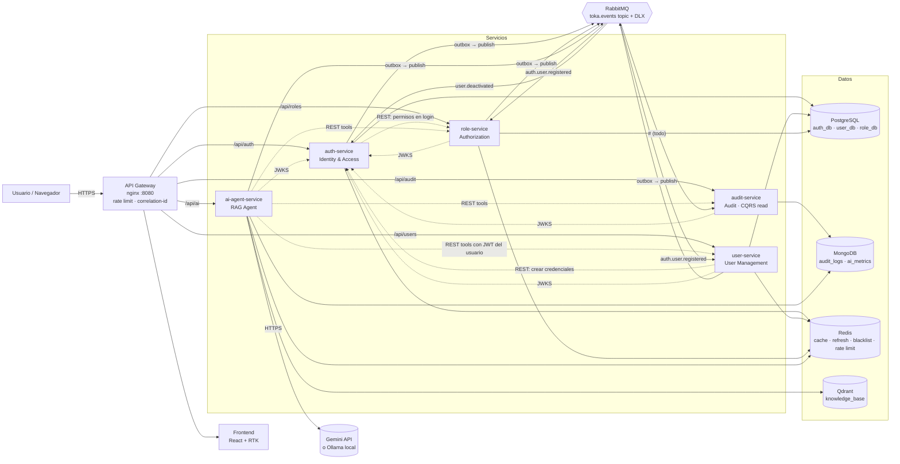

# Ejercicio 1 – Diseño y Arquitectura

## 1. Visión general

Plataforma de gestión de usuarios basada en microservicios con autenticación distribuida (JWT RS256 + JWKS), autorización por roles y permisos, auditoría inmutable de accesos y un agente de IA con RAG. Todo se ejecuta localmente con un solo `docker compose up`.

## 2. Diagrama de arquitectura



## 3. Justificación de decisiones técnicas

| Decisión | Por qué | Alternativa descartada |
|---|---|---|
| **NestJS + TypeScript** | DI nativa (facilita los puertos y adaptadores de Clean Architecture), módulos por bounded context, ecosistema maduro (terminus, throttler, pino) | Express: requiere armar a mano DI y estructura |
| **Monorepo con `@toka/common`** | Logging, guard JWT, publisher y filtros de errores idénticos en todos los servicios, sin duplicar código; cada servicio sigue desplegándose de forma independiente | Copiar el código en cada servicio |
| **PostgreSQL, una BD por servicio** | Datos transaccionales con integridad referencial (roles ↔ permisos ↔ asignaciones). La BD por servicio evita acoplamiento por esquema compartido | BD compartida: rompe la autonomía de los servicios |
| **MongoDB para auditoría** | Eventos append-only, esquema flexible por tipo de evento, alto volumen de escritura, consultas por rango de fechas con índices; TTL nativo para retención | Postgres: posible, pero el esquema rígido choca con eventos heterogéneos |
| **Redis** | Cache de lectura (perfiles, permisos), refresh tokens con TTL, blacklist de `jti`, contador de intentos fallidos, token bucket para la IA. Todo es efímero y requiere baja latencia | Guardarlo en Postgres agrega latencia y carga |
| **RabbitMQ** | Topic exchange para enrutar por tipo de evento, ack manual, DLQ nativa y menor complejidad operativa que Kafka para este volumen | Kafka: preferible para replay y alto throughput, sobredimensionado aquí |
| **JWT RS256 + JWKS** | Solo auth-service tiene la llave privada; los demás validan localmente con la pública (validación distribuida, sin llamar a auth en cada request). Permite rotar llaves por `kid` | HS256: obliga a compartir el secreto con todos los servicios |
| **Refresh token en cookie httpOnly + access token en memoria** | Mitiga XSS (el JS no puede leer el refresh) y CSRF (SameSite=Strict, mismo origen vía gateway) | localStorage: vulnerable a XSS |
| **Transactional Outbox** | Garantiza que el cambio en BD y el evento se publiquen juntos o ninguno (sin dual-write) | Publicar directo después del commit: puede perder eventos |
| **Qdrant** | Vector DB open source en contenedor, filtros por payload y API REST simple | Pinecone: requiere cuenta en la nube |
| **Embeddings locales (MiniLM)** | Costo cero, sin rate limit y sin enviar documentos internos a terceros | Embeddings de API: costo y latencia extra |
| **Gemini con adaptador `LlmProvider`** | Tiene nivel gratuito; el adaptador permite cambiar a OpenAI, Anthropic u Ollama sin tocar casos de uso; `MockProvider` permite tests deterministas | Acoplar el SDK de un proveedor al dominio |
| **nginx como gateway** | Punto único de entrada, mismo origen para el frontend, rate limit por IP, bloquea rutas `/internal` | BFF en Node: no hace falta agregación compleja |

## 4. Flujos de datos principales

**Registro (asíncrono, consistencia eventual)**
1. `POST /api/auth/register`: auth-service valida el input, hashea con argon2 y guarda la credencial junto con `outbox_events(auth.user.registered)` en la misma transacción.
2. El relay publica el evento en `toka.events`.
3. user-service crea el perfil, role-service asigna el rol `USER` y audit-service registra el evento. Cada consumidor es idempotente por `eventId`.

**Login (síncrono con resiliencia)**
1. `POST /api/auth/login`: auth-service verifica la credencial y el lockout en Redis.
2. Llama por REST a role-service `/internal/users/:id/permissions` con timeout de 2 s y circuit breaker. Si el breaker está abierto, usa los permisos cacheados en Redis; si no hay cache, responde 503 (falla cerrada: nunca emite tokens sin permisos conocidos).
3. Firma el access token (15 min), guarda el refresh token en Redis, lo envía en una cookie httpOnly y publica `auth.login.succeeded` o `auth.login.failed`.

**Request autenticado**
El gateway agrega `x-correlation-id`. El servicio valida el JWT con JWKS (cacheado), revisa la blacklist de `jti` en Redis y los permisos con `PermissionsGuard`, y responde. El `correlationId` viaja en los logs y en los eventos.

**Desactivación de usuario (efecto en cascada por eventos)**
user-service cambia el estado y publica `user.deactivated`. auth-service revoca todos los refresh tokens del usuario y audit-service lo registra. El access token vigente expira en 15 min como máximo; para un efecto inmediato, auth agrega los `jti` activos a la blacklist.

**Consulta al agente IA**
`POST /api/ai/chat`: se aplica el rate limit por usuario y se revisa la cache de respuestas. Luego se genera el embedding de la pregunta y se hace la búsqueda top-k en Qdrant. El LLM recibe el contexto y las tools; las tools llaman a user, role y audit **con el JWT del usuario**, así el agente nunca ve más de lo que el usuario puede ver. Después se valida la respuesta, se registran las métricas (latencia, tokens, costo) en Mongo y se publica `ai.query.completed`.

## 5. DDD aplicado

- **Bounded contexts:** Identity & Access (auth), User Management (user), Authorization (role), Audit y AI Assistant. Cada uno tiene su propio lenguaje: en auth un usuario es una *Credential*; en user es un *UserProfile*.
- **Agregados con invariantes en el dominio:**
  - `Credential`: bloqueo tras intentos fallidos, política de contraseña en el VO `Password`.
  - `User`: `deactivate()` falla si ya está inactivo y emite `UserDeactivated`.
  - `Role`: no se puede eliminar el último ADMIN; los permisos son VOs con formato `recurso:acción`.
- **Value Objects:** `Email`, `Password`, `UserId`, `Permission`, `RoleName`. Son inmutables y se validan al construirse.
- **Domain Events:** se generan dentro del agregado; la capa de aplicación los persiste en el outbox. Los contextos se integran **solo por eventos o APIs públicas**, nunca leyendo la BD de otro servicio.
- **Anti-Corruption Layer:** los clientes HTTP de `infrastructure/http` traducen las respuestas externas a modelos propios.

## 6. Clean Architecture aplicada

```
presentation (controllers, guards, DTO HTTP)
      ↓
application (use cases, puertos: EventPublisher, Cache, LlmProvider, RoleClient)
      ↓
domain (entidades, VOs, eventos, interfaces de repositorio)  ← no conoce Nest, Prisma ni Rabbit
      ↑ implementa
infrastructure (Prisma, Mongoose, amqplib, ioredis, axios, Gemini)
```

- Los casos de uso (`RegisterUserUseCase`, `AssignRoleUseCase`, `AskAgentUseCase`) dependen de interfaces y se prueban con implementaciones en memoria.
- Cambiar Prisma por TypeORM, o Gemini por OpenAI, solo toca `infrastructure`.
- **CQRS:** audit-service es un read model puro, alimentado por eventos, con consultas optimizadas (índices por tipo, fecha y actor). En user y role se separan los casos de uso de comando de los de consulta, y las consultas usan cache.

## 7. Seguridad (OWASP)

- **A01 Broken Access Control:** guards por permiso, verificación de ownership (`/users/:id`), rutas `/internal` bloqueadas en el gateway y protegidas con `x-internal-key`. El agente IA usa el JWT del usuario.
- **A02 Cryptographic Failures:** argon2id, RS256 y refresh token en cookie httpOnly, Secure y SameSite=Strict.
- **A03 Injection:** validación con whitelist, Prisma con queries parametrizadas, sanitización de filtros de Mongo (rechazar operadores `$`), y defensa contra prompt injection en el agente (las instrucciones de los documentos se tratan como datos).
- **A04/A07:** lockout por intentos fallidos, rate limiting en el gateway y en el servicio, y mensajes de login genéricos.
- **A05:** helmet, CORS restringido y contenedores non-root.
- **A09 Logging:** todo acceso queda auditado; los logs redactan secretos.

## 8. Escalabilidad y resiliencia

- Los servicios son stateless (el estado vive en Redis o BD), así que escalan horizontalmente con `docker compose up --scale user-service=3`, y las colas de RabbitMQ reparten la carga entre consumidores.
- **Timeouts y circuit breakers** en toda llamada síncrona, con fallback a cache. Esto evita fallos en cascada.
- **Retries con backoff** solo en operaciones idempotentes. Los consumidores son idempotentes y, tras 3 intentos, el mensaje va a la DLQ.
- Healthchecks en Docker, y `depends_on: condition: service_healthy` para el orden de arranque.
- La degradación de la IA es controlada: si el LLM falla o hay 429, se reintenta con backoff; si el breaker está abierto, se responde con los fragmentos RAG sin generación y se informa al usuario.
- La observabilidad se basa en logs JSON con `correlationId`, que permiten trazar una petición a través de todos los servicios (por ejemplo, con `docker compose logs | jq`).

## 9. Docker Compose

Ver `docker-compose.yml` en la raíz. Organización:
- **Infraestructura:** postgres, mongo, redis, rabbitmq (con definitions precargadas) y qdrant, todos con healthcheck y volumen nombrado.
- **Servicios:** auth, user, role, audit y ai-agent. Cada uno se construye desde la raíz del monorepo (`context: .`) con su `Dockerfile`.
- **Borde:** gateway (nginx :8080) y frontend.
- **Perfil opcional `local-llm`:** Ollama, para correr el agente sin internet (`docker compose --profile local-llm up`).
- Una sola red interna `toka-net`. Solo se exponen al host el gateway (8080) y, para depuración, la consola de RabbitMQ (15672).
