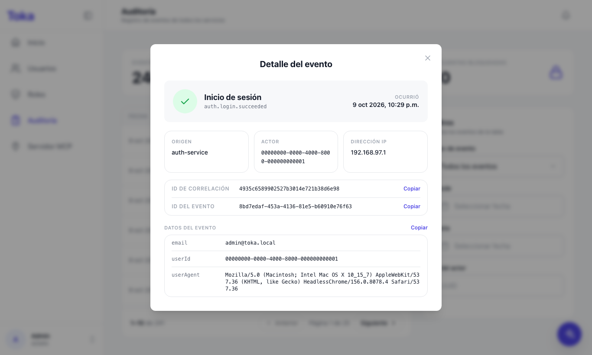
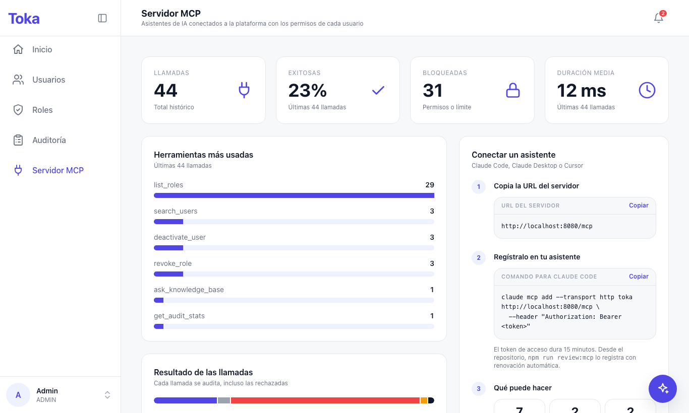
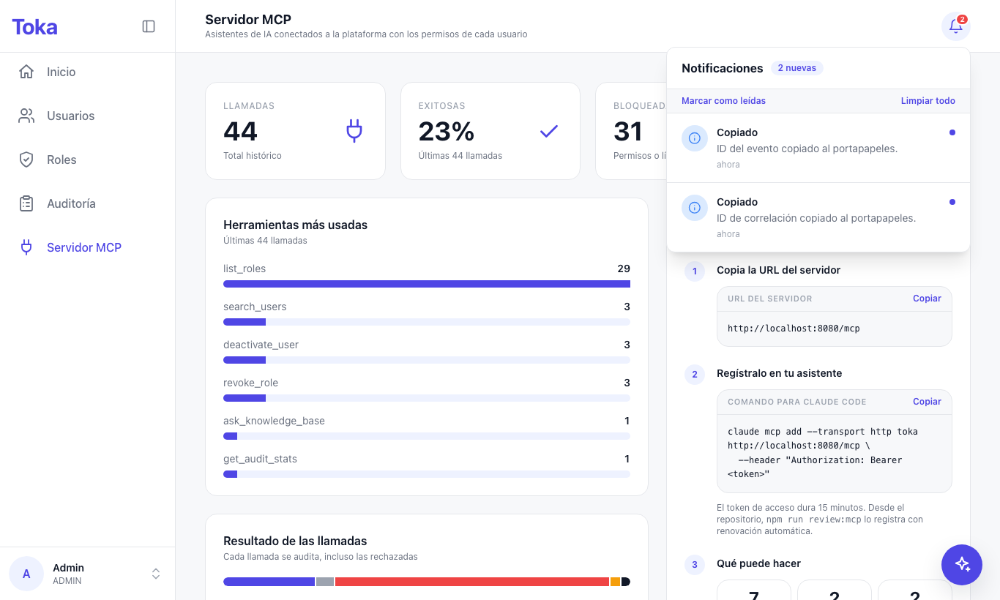
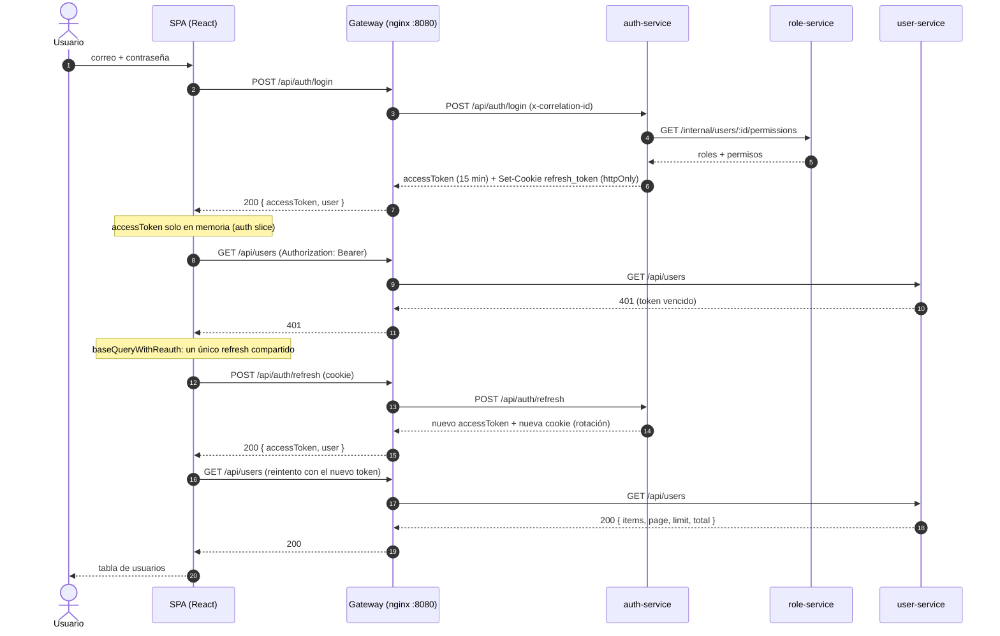

# Ejercicio 3 – Frontend

SPA de administración de la plataforma Toka: autenticación, usuarios, roles, auditoría, observabilidad del servidor MCP y asistente de IA. Consume únicamente el API Gateway (`/api/*`), nunca un microservicio directo.

## 1. Resumen

| Pieza | Elección | Por qué |
|---|---|---|
| UI | React 18 + TypeScript estricto | Ecosistema maduro; `strict` detecta en compilación los desajustes con los contratos de la API ([src/@types/api.ts](../frontend/src/@types/api.ts)). |
| Build | Vite 6 | Arranque y HMR rápidos. Es una app privada tras login: no necesita SSR ni SEO, así que Next.js sería complejidad sin beneficio (patrón B). |
| Estado global | Redux Toolkit | Un único store con cuatro reducers (`api`, `auth`, `toasts`, `notifications`) y un middleware de listeners para efectos transversales. |
| Datos del servidor | RTK Query | Caché, estados `isLoading`/`isError`, invalidación por etiquetas y reintento centralizado en un `baseQuery`; evita escribir a mano `useEffect` + `fetch` + estado. |
| Formularios | react-hook-form + zod | Validación declarativa y tipada; los esquemas ([src/validators/](../frontend/src/validators/)) se reutilizan entre login, registro y edición. |
| Estilos | Tailwind 3 | Tokens del design system (color, radios, sombras) sin CSS por componente; un solo acento morado y colores de estado reservados para éxito, error y advertencia. |
| Tests | Jest + React Testing Library + MSW | Los formularios se prueban contra HTTP simulado, no contra mocks de hooks. |

Trade-off principal: RTK Query añade una capa de conceptos (tags, `injectEndpoints`) frente a un `fetch` simple, pero a cambio elimina la gestión manual de caché y de refresco tras cada mutación.

## 2. Pantallas

Capturas tomadas con Playwright (Chromium, 1366×820) contra el stack real servido por el gateway (`docker compose up -d`), entrando como `admin@toka.local`. La estructura común es un sidebar retráctil (inicio, usuarios, roles, auditoría y servidor MCP, según permisos) y, en cada pantalla, un encabezado fijo con el título y la campana de notificaciones; solo el contenido hace scroll.

**Login.** Tarjeta translúcida con la palabra Toka, correo y contraseña. Los campos muestran una palomita verde cuando son válidos y borde rojo con relleno tenue y mensaje cuando no; el espacio del mensaje está siempre reservado, así que la tarjeta nunca cambia de tamaño.


**Inicio.** Cuatro tarjetas de acceso (usuarios, roles, auditoría y servidor MCP) con contadores reales, generadas desde la misma tabla de navegación que el menú. Para quien puede leer auditoría, además: eventos por tipo, resultado de los inicios de sesión y actividad reciente.


**Usuarios.** Tabla paginada con búsqueda con debounce, filtro de estado en pestañas y tamaño de página. Cada fila ofrece botones con texto («Editar», «Desactivar» o «Activar», estos últimos con confirmación) y el alta de usuarios se hace en un modal.


**Roles.** Una sola vista: arriba las tarjetas de los tres roles, con un medidor de permisos y etiquetas por recurso; debajo, las asignaciones en tres columnas: lista de usuarios con búsqueda, detalle del elegido (roles y permisos efectivos) y un panel «Agregar rol» donde se escoge el rol y se previsualizan sus permisos antes de asignarlo. Quitar un rol pide confirmación.


**Auditoría.** Tarjetas de estadísticas y una tabla paginada (10 filas) acotada a la altura de la pantalla. Los filtros están en un panel lateral: tipo de evento (dropdown propio), rango de fechas (calendario propio) e ID del actor. El ícono de ojo abre el detalle del evento en un modal.


**Detalle de un evento.** Cabecera con el tipo de evento y su resultado, origen, actor, IP, identificadores con botón «Copiar» y los datos del evento como filas clave/valor.



**Servidor MCP.** Observabilidad del módulo extra ([06-mcp-server.md](06-mcp-server.md)): llamadas totales, porcentaje de éxito, llamadas bloqueadas y duración media; herramientas más usadas; resultado de las llamadas (exitosa, vista previa, denegada, límite alcanzado, error) y las últimas invocaciones. Los datos salen de los eventos `mcp.tool.invoked` de la auditoría, así que incluyen también las llamadas rechazadas. La tarjeta «Conectar un asistente» da la URL del servidor y el comando `claude mcp add`, ambos copiables. Requiere `audit:read`.



**Notificaciones.** La campana del encabezado guarda cada aviso que la aplicación mostró como toast (éxito, error, información, advertencia) y, para quien puede leer auditoría, avisa de intentos de inicio de sesión fallidos y cuentas bloqueadas nuevas, consultando cada 30 s. Muestra el número de no leídas y permite marcarlas como leídas o limpiarlas.



**Asistente IA.** Botón flotante en la esquina (para quien tiene `ai:use`) que abre el chat: preguntas sugeridas, indicador de escritura, respuesta con fuentes citadas con su relevancia y, en «Detalles técnicos», las métricas (modelo, latencia, tokens, costo, caché, calidad). La conversación se conserva al cerrar el panel.

")

**Error de validación.** Se envió el formulario con un correo mal formado y la contraseña vacía; los mensajes salen de zod, sin ninguna petición al servidor.


**Estado de carga.** La petición `GET /api/users` se retrasó 4 s artificialmente para capturar el esqueleto de la tabla.


> La captura del asistente la generó el `MockProvider` (no hay `GEMINI_API_KEY` en este entorno), por eso el modelo aparece como `mock` y el costo como $0. Ver limitaciones en el [README raíz](../README.md).

## 3. State management

Un solo store en [src/api/store.ts](../frontend/src/api/store.ts):

| Clave | Origen | Contenido |
|---|---|---|
| `api` | [src/api/api.ts](../frontend/src/api/api.ts) | Caché RTK Query (usuarios, roles, auditoría, chat). |
| `auth` | [src/api/auth-slice.ts](../frontend/src/api/auth-slice.ts) | `status` (`bootstrapping`/`authenticated`/`anonymous`), `accessToken` y `user`. |
| `toasts` | [src/api/toast-slice.ts](../frontend/src/api/toast-slice.ts) | Avisos efímeros de éxito, error, información y advertencia (con título opcional). |
| `notifications` | [src/api/notification-slice.ts](../frontend/src/api/notification-slice.ts) | Historial de avisos de la sesión, con estado leído/no leído; alimenta la campana. |

### RTK Query y etiquetas de invalidación

Hay un único `createApi` con `tagTypes: ['User', 'UserRoles', 'Role']` y cada dominio inyecta sus endpoints desde su archivo (`auth.api.ts`, `users.api.ts`, `roles.api.ts`, `audit.api.ts`, `ai.api.ts`).

| Endpoint | Provee | Invalida |
|---|---|---|
| `listUsers` | `User` (lista) | — |
| `createUser`, `updateUser`, `deactivateUser`, `activateUser` | — | `User` (lista) |
| `listRoles` | `Role` | — |
| `getUserRoles(userId)` | `UserRoles:{userId}` | — |
| `assignRole`, `revokeRole` | — | `UserRoles:{userId}` |

Así, tras crear o editar un usuario la tabla se refresca sola, y al asignar un rol solo se recarga el panel de ese usuario, no el resto.

### Access token en memoria y refresh automático ante 401

El access token vive solo en `auth.accessToken`, nunca en `localStorage` (no es legible por XSS). Al recargar la página se pierde y [src/main.tsx](../frontend/src/main.tsx) restaura la sesión con la cookie httpOnly de refresh antes de renderizar; mientras tanto `status` es `bootstrapping` y los guards muestran un loader.

[src/api/base-query.ts](../frontend/src/api/base-query.ts) envuelve `fetchBaseQuery`: ante un 401 pide un refresh y reintenta la petición original; si el refresh falla, cierra la sesión. `login`, `register` y `refresh` están excluidos (un 401 ahí es una credencial incorrecta).

```ts
// Refresh tokens rotate on every use and reuse is treated as theft, so concurrent callers
// (several 401s at once, or React StrictMode) must share a single request.
export const refreshSession = (): Promise<Session | null> => {
  inFlightRefresh ??= fetch(REFRESH_URL, { method: 'POST', credentials: 'same-origin' })
    .then((response) => (response.ok ? (response.json() as Promise<Session>) : null))
    .catch(() => null)
    .finally(() => {
      inFlightRefresh = null;
    });
  return inFlightRefresh;
};
```

La promesa en vuelo compartida es la pieza clave: como el backend rota el refresh token en cada uso y trata su reutilización como robo, dos refresh simultáneos cerrarían la sesión. Se verificó en navegador forzando dos 401 concurrentes: sale un solo `POST /api/auth/refresh`.

### Efectos transversales (listeners)

En `store.ts`, tres listeners evitan repetir lógica en las pantallas:

- Todo rechazo de RTK Query se convierte en un toast con el `detail` de ProblemDetails (RFC 7807), salvo `SESSION_EXPIRED`, que lleva a `/login`.
- Todo toast se registra también como notificación, para poder revisarlo cuando ya se desvaneció.
- Al limpiar la sesión se ejecuta `api.util.resetApiState()` y se vacían las notificaciones, para que el siguiente usuario no vea la caché ni los avisos del anterior.

Además, `useSecurityAlerts` consulta `GET /api/audit/stats` cada 30 s para quien tiene `audit:read` y crea una notificación cuando aumentan los inicios fallidos o las cuentas bloqueadas.

## 4. Integración con los microservicios

Todas las llamadas salen a `/api/...` y el gateway nginx (puerto 8080) las enruta. Las rutas `/api/*/internal/*` están bloqueadas desde fuera.

| Pantalla | Acción | Endpoint | Servicio |
|---|---|---|---|
| Login / arranque | Iniciar sesión | `POST /api/auth/login` | auth-service |
| Arranque / 401 | Refrescar token | `POST /api/auth/refresh` | auth-service |
| Menú de usuario (sidebar) | Cerrar sesión | `POST /api/auth/logout` | auth-service |
| Registro | Crear cuenta | `POST /api/auth/register` | auth-service |
| Usuarios | Listar, buscar, filtrar | `GET /api/users` | user-service |
| Usuarios | Crear | `POST /api/users` | user-service |
| Usuarios | Editar | `PATCH /api/users/:id` | user-service |
| Usuarios | Desactivar / activar | `POST /api/users/:id/deactivate` · `/activate` | user-service |
| Roles | Catálogo | `GET /api/roles` | role-service |
| Roles | Roles de un usuario | `GET /api/roles/users/:userId` | role-service |
| Roles | Asignar / quitar | `POST /api/roles/users/:userId/assign` · `DELETE /api/roles/users/:userId/roles/:roleId` | role-service |
| Auditoría | Eventos | `GET /api/audit` | audit-service |
| Auditoría | Estadísticas | `GET /api/audit/stats` | audit-service |
| Inicio | Contadores, gráficas y actividad reciente | `GET /api/users`, `GET /api/roles`, `GET /api/audit/stats`, `GET /api/audit` | user, role y audit-service |
| Servidor MCP | Llamadas de los asistentes | `GET /api/audit?type=mcp.tool.invoked` | audit-service |
| Notificaciones | Alertas de seguridad (cada 30 s) | `GET /api/audit/stats` | audit-service |
| Asistente flotante | Pregunta | `POST /api/ai/chat` | ai-agent-service |

### Login con refresh de token



El user-service valida el JWT localmente con el JWKS de auth (con caché), sin llamar a auth en cada petición.

## 5. UX

- **Carga**: esqueletos ([Skeleton.tsx](../frontend/src/components/ui/Skeleton.tsx)) en tablas, tarjetas y paneles; `Button` con `loading` bloquea el envío doble; el chat muestra un indicador de escritura mientras responde. Al restaurar la sesión se muestra un loader en vez de redirigir a `/login`.
- **Error**: el listener del store muestra un toast con el `detail` del servidor. Las listas fallidas ofrecen «reintentar» (`refetch`). El asistente muestra un aviso específico cuando el servicio responde 503.
- **Feedback**: toasts dinámicos (`useToast`: éxito, error, información y advertencia, con título opcional y barra de progreso) tras cada acción. Las acciones de riesgo (desactivar un usuario, quitar un rol) piden confirmación con un único diálogo reutilizable: `if (await confirm({...})) …` ([use-confirm.tsx](../frontend/src/hooks/use-confirm.tsx) y [ConfirmDialog.tsx](../frontend/src/components/ui/ConfirmDialog.tsx)).
- **Validación**: esquemas zod compartidos; los errores aparecen bajo cada campo (con espacio reservado para que el diseño no salte) y la contraseña muestra sus requisitos. Los campos válidos se marcan con una palomita. No se envía ninguna petición si el formulario es inválido.
- **Rutas protegidas por permiso**: [src/routes/guards.tsx](../frontend/src/routes/guards.tsx) define `RequireAuth`, `GuestOnly` y `RequirePermission`. Una única tabla ([navigation.tsx](../frontend/src/routes/navigation.tsx)) alimenta menú, tarjetas de inicio y rutas, con su permiso (`users:read`, `roles:read`, `audit:read`, `ai:use`). Quien no lo tiene ve «Acceso restringido». Es solo UX: el backend revalida cada petición.
- **Componentes propios**: dropdown ([Select.tsx](../frontend/src/components/ui/Select.tsx)) y calendario ([DatePicker.tsx](../frontend/src/components/ui/DatePicker.tsx)) con los colores de la interfaz, navegables con teclado. Se dibujan en un portal sobre el `body` ([FloatingPanel.tsx](../frontend/src/components/ui/FloatingPanel.tsx)), por lo que ningún contenedor con scroll puede cortarlos, y se abren hacia arriba si no hay espacio debajo.
- **Layout**: la aplicación ocupa exactamente la altura de la pantalla; el sidebar y el encabezado quedan fijos y solo el contenido hace scroll, sin rebote elástico. El sidebar se contrae a solo íconos sin que estos cambien de posición.
- **Accesibilidad**: `aria-live` en el chat, `role="alert"`/`status` en los toasts, `aria-busy` en el loader de sesión, `aria-expanded` en el sidebar y los menús, etiquetas accesibles cuando solo se ven íconos y radios reales en los selectores de rol.

## 6. Tests

Jest 30 + React Testing Library + MSW 2 (con `@swc/jest`; ver `docs/decisiones.md`, Fase 7). Se prueban los flujos sensibles, no la cobertura total:

| Suite | Qué verifica |
|---|---|
| `test/pages/LoginPage.test.tsx` | Validación sin petición, sesión en el store, `detail` de ProblemDetails y error sin cuerpo. |
| `test/pages/RegisterPage.test.tsx` | Requisitos de contraseña, éxito con redirección, correo duplicado. |
| `test/api/auth-slice.test.ts` | Reducers y selectores de sesión. |
| `test/pages/UsersPage.test.tsx` | Esqueleto, datos, error con reintento, vacío, acciones según `users:write` y confirmación al desactivar (confirmar y cancelar). |
| `test/routes/guards.test.tsx` | `RequirePermission`: permitido, denegado y reacción a cambios de sesión. |
| `test/api/base-query.test.ts` | Refresh de token compartido entre peticiones con 401 simultáneas, sesión cerrada si el refresh falla y sin refresh en el login. |
| `test/components/NotificationBell.test.tsx` | Los toasts quedan como notificaciones sin leer, marcar como leídas y limpiar. |
| `test/pages/McpPage.test.tsx` y `test/utils/mcp-calls.test.ts` | Resumen de llamadas MCP (éxito, bloqueadas, duración, herramientas), estado vacío, error con reintento y datos de conexión. |
| `test/pages/AssistantWidget.test.tsx` | Botón flotante, preguntas sugeridas, fuentes citadas, reenvío de `conversationId` y aviso ante 503. |
| `test/components/Select.test.tsx` y `DatePicker.test.tsx` | Dropdown y calendario propios: ratón, teclado, cambio de mes y limpiar. |

```bash
cd frontend
npm test                 # 51 tests
npm run test:coverage    # con reporte en frontend/coverage/
npm run typecheck:test   # typecheck de los tests
npm run lint             # Biome
```

Resultado (última ejecución): **12 suites, 51 tests pasando**. Coverage global: statements **87.67 %**, branches **74.66 %**, functions **80.50 %**, lines **89.78 %**. Login, registro y el slice de auth están al 100 %. El refresh de token está cubierto por `test/api/base-query.test.ts`: varias peticiones con 401 simultáneas comparten una sola petición de refresh, un refresh fallido cierra la sesión y un 401 del login no dispara refresh.

**Deuda declarada**: los guards `RequireAuth`/`GuestOnly` no tienen tests automatizados; se verificaron a mano en navegador.

## 7. Ejecución

### Desarrollo (`npm run dev`)

El frontend no es workspace de npm (rompería el `npm ci` de los Dockerfiles de servicios), así que se instala aparte y necesita el backend levantado:

```bash
docker compose up -d --build      # backend + gateway en :8080
cd frontend
npm install
npm run dev                       # http://localhost:5173
```

[vite.config.ts](../frontend/vite.config.ts) reenvía `/api` y `/mcp` a `http://localhost:8080`; el navegador ve un único origen, así que la cookie httpOnly de refresh (`SameSite=Strict`, path `/api/auth`) se comporta igual que en producción.

### Con Docker

[frontend/Dockerfile](../frontend/Dockerfile) es multi-stage: compila con `node:22-alpine` y sirve `dist/` con `nginx-unprivileged` (no-root, puerto 8080, `HEALTHCHECK`, fallback de rutas de SPA y CSP en [frontend/nginx.conf](../frontend/nginx.conf)).

Servicio en [docker-compose.yml](../docker-compose.yml):

```yaml
  frontend:
    build: { context: ., dockerfile: frontend/Dockerfile }
    networks: [toka-net]
```

No publica puertos: se accede a través del gateway, que lo declara en `depends_on` y le enruta `/`:

```bash
docker compose up -d --build
# Aplicación: http://localhost:8080  ·  admin@toka.local / Admin123!
npm run review:seed   # opcional: crea manager@toka.local y user@toka.local (Demo1234!)
```
