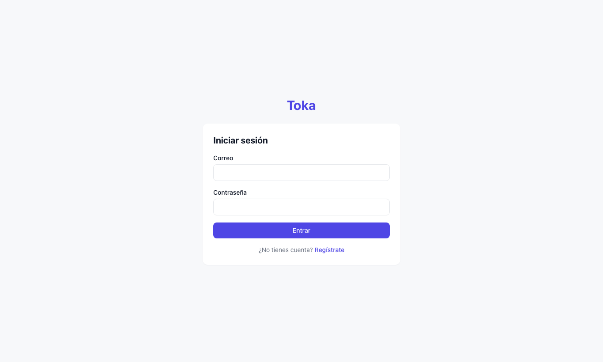
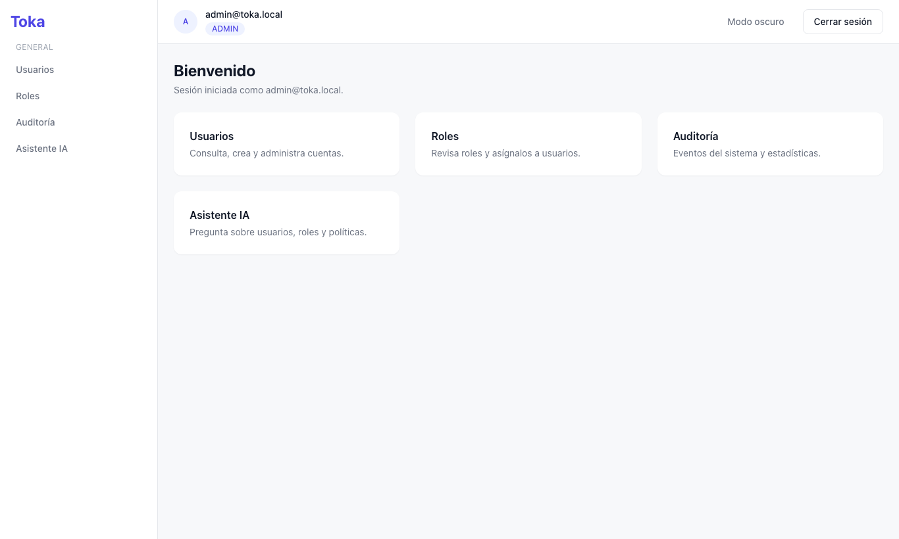
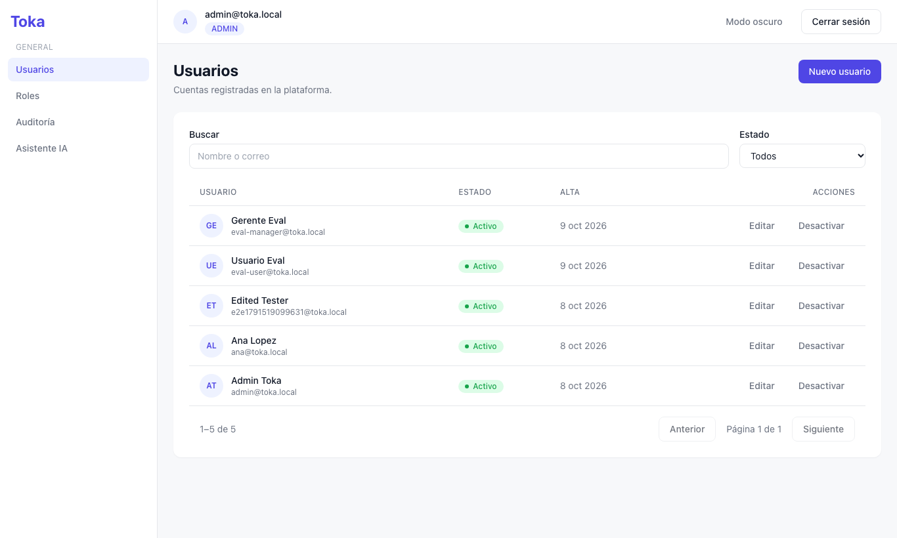
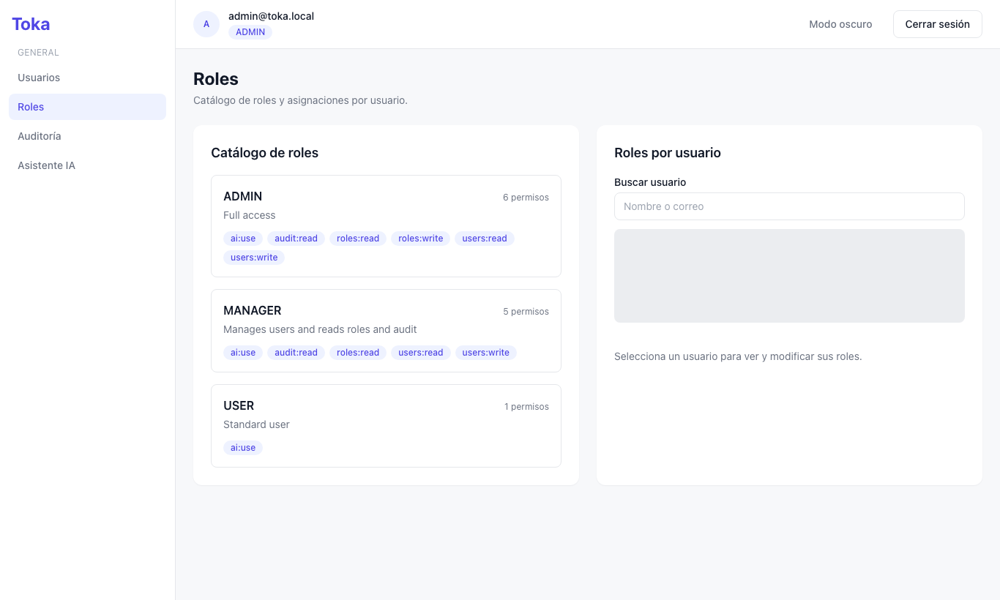
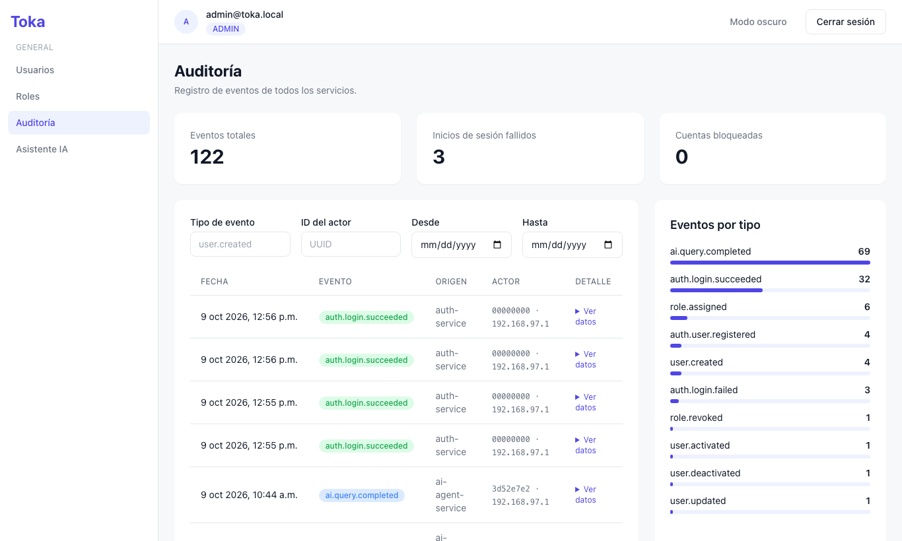
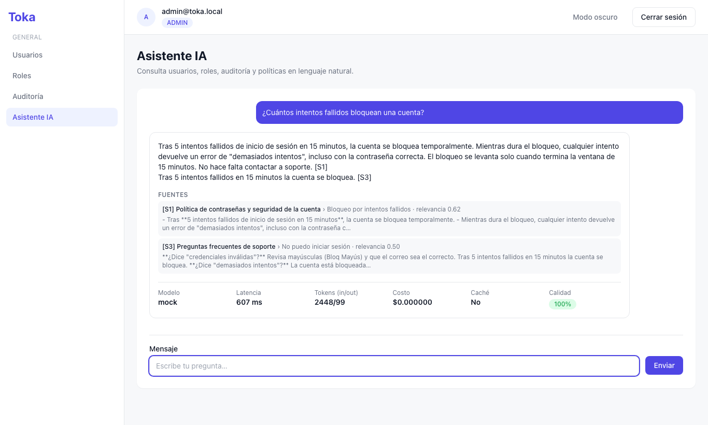
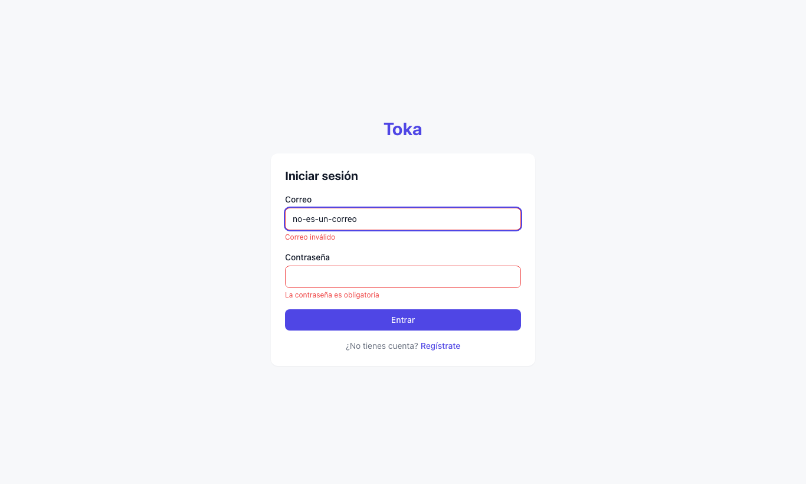
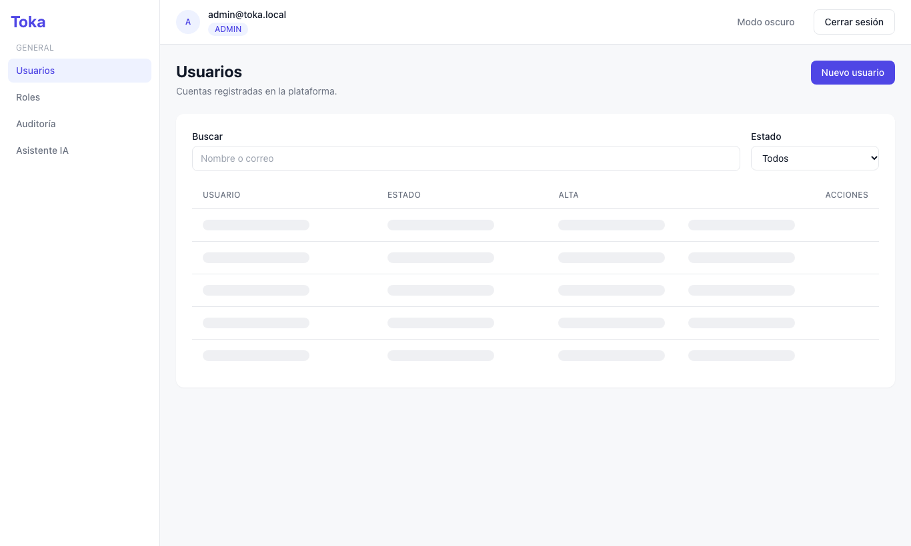
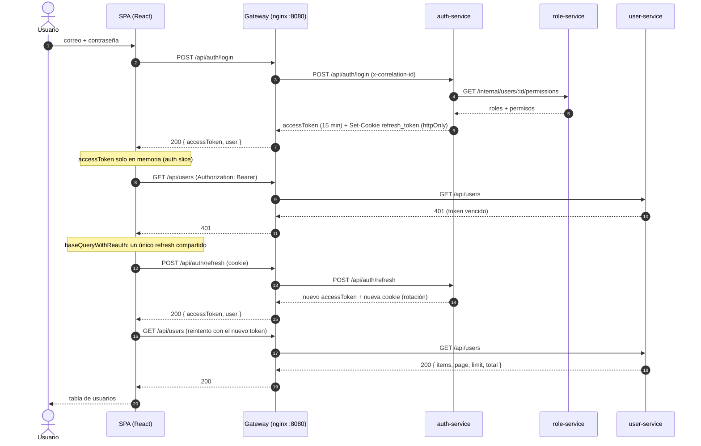

# Ejercicio 3 – Frontend

SPA de administración de la plataforma Toka: autenticación, usuarios, roles, auditoría y asistente de IA. Consume únicamente el API Gateway (`/api/*`), nunca un microservicio directo.

## 1. Resumen

| Pieza | Elección | Por qué |
|---|---|---|
| UI | React 18 + TypeScript estricto | Ecosistema maduro; `strict` detecta en compilación los desajustes con los contratos de la API ([src/@types/api.ts](../frontend/src/@types/api.ts)). |
| Build | Vite 6 | Arranque y HMR rápidos. Es una app privada tras login: no necesita SSR ni SEO, así que Next.js sería complejidad sin beneficio (patrón B). |
| Estado global | Redux Toolkit | Un único store con tres reducers (`api`, `auth`, `toasts`) y un middleware de listeners para efectos transversales. |
| Datos del servidor | RTK Query | Caché, estados `isLoading`/`isError`, invalidación por etiquetas y reintento centralizado en un `baseQuery`; evita escribir a mano `useEffect` + `fetch` + estado. |
| Formularios | react-hook-form + zod | Validación declarativa y tipada; los esquemas ([src/validators/](../frontend/src/validators/)) se reutilizan entre login, registro y edición. |
| Estilos | Tailwind 3 | Tokens del design system (modo claro/oscuro) sin CSS por componente. |
| Tests | Jest + React Testing Library + MSW | Los formularios se prueban contra HTTP simulado, no contra mocks de hooks. |

Trade-off principal: RTK Query añade una capa de conceptos (tags, `injectEndpoints`) frente a un `fetch` simple, pero a cambio elimina la gestión manual de caché y de refresco tras cada mutación.

## 2. Pantallas

Capturas tomadas con Playwright (Chromium, 1366×820) contra el stack real levantado con `docker compose up -d`, entrando como `admin@toka.local`.

| Pantalla | Captura |
|---|---|
| Login |  |
| Inicio |  |
| Usuarios |  |
| Roles |  |
| Auditoría |  |
| Asistente IA |  |
| Error de validación |  |
| Estado de carga |  |

- **Login**: tarjeta centrada con correo y contraseña; enlace a registro.
- **Inicio**: tarjetas de acceso a cada sección, generadas desde la misma tabla de navegación que el menú.
- **Usuarios**: búsqueda con debounce, filtro de estado, paginación, y acciones crear, editar y activar/desactivar (con diálogo de confirmación).
- **Roles**: catálogo de roles con sus permisos y panel para asignar o quitar roles a un usuario.
- **Auditoría**: tarjetas de estadísticas (eventos totales, cuentas bloqueadas…), eventos por tipo y listado filtrable.
- **Asistente IA**: chat con la respuesta, fuentes citadas con su relevancia, y métricas (modelo, latencia, tokens, costo, caché, calidad).
- **Error de validación**: se envió el formulario con un correo mal formado y la contraseña vacía; los mensajes salen de zod, sin ninguna petición al servidor.
- **Estado de carga**: la petición `GET /api/users` se retrasó 4 s artificialmente para capturar el esqueleto de la tabla.

> La captura del asistente la generó el `MockProvider` (no hay `GEMINI_API_KEY` en este entorno), por eso el modelo aparece como `mock` y el costo como $0. Ver limitaciones en el [README raíz](../README.md).

## 3. State management

Un solo store en [src/api/store.ts](../frontend/src/api/store.ts):

| Clave | Origen | Contenido |
|---|---|---|
| `api` | [src/api/api.ts](../frontend/src/api/api.ts) | Caché RTK Query (usuarios, roles, auditoría, chat). |
| `auth` | [src/api/auth-slice.ts](../frontend/src/api/auth-slice.ts) | `status` (`bootstrapping`/`authenticated`/`anonymous`), `accessToken` y `user`. |
| `toasts` | [src/api/toast-slice.ts](../frontend/src/api/toast-slice.ts) | Notificaciones de éxito y error. |

### RTK Query y etiquetas de invalidación

Hay un único `createApi` con `tagTypes: ['User', 'UserRoles', 'Role']` y cada dominio inyecta sus endpoints desde su archivo (`auth.api.ts`, `users.api.ts`, `roles.api.ts`, `audit.api.ts`, `ai.api.ts`).

| Endpoint | Provee | Invalida |
|---|---|---|
| `listUsers` | `User` (lista) | — |
| `createUser`, `updateUser`, `deactivateUser`, `activateUser` | — | `User` (lista) |
| `listRoles` | `Role` | — |
| `getUserRoles(userId)` | `UserRoles:{userId}` | — |
| `assignRole`, `revokeRole` | — | `UserRoles:{userId}` |

Así, tras crear o editar un usuario la tabla se refresca sola, y al asignar un rol solo se recarga el panel de ese usuario, no el resto.

### Access token en memoria y refresh automático ante 401

El access token vive solo en `auth.accessToken`, nunca en `localStorage` (no es legible por XSS). Al recargar la página se pierde y [src/main.tsx](../frontend/src/main.tsx) restaura la sesión con la cookie httpOnly de refresh antes de renderizar; mientras tanto `status` es `bootstrapping` y los guards muestran un loader.

[src/api/base-query.ts](../frontend/src/api/base-query.ts) envuelve `fetchBaseQuery`: ante un 401 pide un refresh y reintenta la petición original; si el refresh falla, cierra la sesión. `login`, `register` y `refresh` están excluidos (un 401 ahí es una credencial incorrecta).

```ts
// Refresh tokens rotate on every use and reuse is treated as theft, so concurrent callers
// (several 401s at once, or React StrictMode) must share a single request.
export const refreshSession = (): Promise<Session | null> => {
  inFlightRefresh ??= fetch(REFRESH_URL, { method: 'POST', credentials: 'same-origin' })
    .then((response) => (response.ok ? (response.json() as Promise<Session>) : null))
    .catch(() => null)
    .finally(() => {
      inFlightRefresh = null;
    });
  return inFlightRefresh;
};
```

La promesa en vuelo compartida es la pieza clave: como el backend rota el refresh token en cada uso y trata su reutilización como robo, dos refresh simultáneos cerrarían la sesión. Se verificó en navegador forzando dos 401 concurrentes: sale un solo `POST /api/auth/refresh`.

### Efectos transversales (listeners)

En `store.ts`, dos listeners evitan repetir lógica en las pantallas:

- Todo rechazo de RTK Query se convierte en un toast con el `detail` de ProblemDetails (RFC 7807), salvo `SESSION_EXPIRED`, que lleva a `/login`.
- Al limpiar la sesión se ejecuta `api.util.resetApiState()`, para que el siguiente usuario no vea la caché del anterior.

## 4. Integración con los microservicios

Todas las llamadas salen a `/api/...` y el gateway nginx (puerto 8080) las enruta. Las rutas `/api/*/internal/*` están bloqueadas desde fuera.

| Pantalla | Acción | Endpoint | Servicio |
|---|---|---|---|
| Login / arranque | Iniciar sesión | `POST /api/auth/login` | auth-service |
| Arranque / 401 | Refrescar token | `POST /api/auth/refresh` | auth-service |
| Header | Cerrar sesión | `POST /api/auth/logout` | auth-service |
| Registro | Crear cuenta | `POST /api/auth/register` | auth-service |
| Usuarios | Listar, buscar, filtrar | `GET /api/users` | user-service |
| Usuarios | Crear | `POST /api/users` | user-service |
| Usuarios | Editar | `PATCH /api/users/:id` | user-service |
| Usuarios | Desactivar / activar | `POST /api/users/:id/deactivate` · `/activate` | user-service |
| Roles | Catálogo | `GET /api/roles` | role-service |
| Roles | Roles de un usuario | `GET /api/roles/users/:userId` | role-service |
| Roles | Asignar / quitar | `POST /api/roles/users/:userId/assign` · `DELETE /api/roles/users/:userId/roles/:roleId` | role-service |
| Auditoría | Eventos | `GET /api/audit` | audit-service |
| Auditoría | Estadísticas | `GET /api/audit/stats` | audit-service |
| Asistente IA | Pregunta | `POST /api/ai/chat` | ai-agent-service |

### Login con refresh de token



El user-service valida el JWT localmente con el JWKS de auth (con caché), sin llamar a auth en cada petición.

## 5. UX

- **Carga**: esqueletos ([Skeleton.tsx](../frontend/src/components/ui/Skeleton.tsx)) en tablas y tarjetas de estadísticas; `Button` con `loading` bloquea el envío doble; el chat muestra un indicador mientras responde. Al restaurar la sesión se muestra un loader en vez de redirigir a `/login`.
- **Error**: el listener del store muestra un toast con el `detail` del servidor. Las listas fallidas ofrecen «reintentar» (`refetch`). El asistente muestra un aviso específico cuando el servicio responde 503.
- **Éxito**: toasts de confirmación tras crear, editar, activar/desactivar y asignar/quitar roles. Las acciones destructivas piden confirmación ([ConfirmDialog.tsx](../frontend/src/components/ui/ConfirmDialog.tsx)).
- **Validación**: esquemas zod compartidos; los errores aparecen bajo cada campo, y la contraseña muestra sus requisitos (mínimo 8, mayúscula, minúscula, número y símbolo). No se envía ninguna petición si el formulario es inválido.
- **Rutas protegidas por permiso**: [src/routes/guards.tsx](../frontend/src/routes/guards.tsx) define `RequireAuth`, `GuestOnly` y `RequirePermission`. Una única tabla ([navigation.tsx](../frontend/src/routes/navigation.tsx)) alimenta menú, tarjetas de inicio y rutas, con su permiso (`users:read`, `roles:read`, `audit:read`, `ai:use`). Quien no lo tiene ve «Acceso restringido». Es solo UX: el backend revalida cada petición.
- **Accesibilidad y tema**: `aria-live` en el chat, `role="alert"`/`status` en los toasts, `aria-busy` en el loader de sesión, y modo oscuro persistido (respeta `prefers-color-scheme`).

## 6. Tests

Jest 30 + React Testing Library + MSW 2 (con `@swc/jest`; ver `docs/decisiones.md`, Fase 7). Se prueban los flujos sensibles, no la cobertura total:

| Suite | Qué verifica |
|---|---|
| `test/pages/LoginPage.test.tsx` | Validación sin petición, sesión en el store, `detail` de ProblemDetails y error sin cuerpo. |
| `test/pages/RegisterPage.test.tsx` | Requisitos de contraseña, éxito con redirección, correo duplicado. |
| `test/api/auth-slice.test.ts` | Reducers y selectores de sesión. |
| `test/pages/UsersPage.test.tsx` | Esqueleto, datos, error con reintento, vacío y acciones según `users:write`. |
| `test/routes/guards.test.tsx` | `RequirePermission`: permitido, denegado y reacción a cambios de sesión. |
| `test/pages/AssistantPage.test.tsx` | Fuentes citadas, reenvío de `conversationId` y aviso ante 503. |

```bash
cd frontend
npm test                 # 29 tests
npm run test:coverage    # con reporte en frontend/coverage/
npm run typecheck:test   # typecheck de los tests
npm run lint             # Biome
```

Resultado (última ejecución): **6 suites, 29 tests pasando**. Coverage global: statements **77.48 %**, branches **59.01 %**, functions **66.08 %**, lines **80.00 %**. Login, registro y el slice de auth están al 100 %.

**Deuda declarada**: el refresh single-flight de `base-query.ts` y los guards `RequireAuth`/`GuestOnly` no tienen tests automatizados; se verificaron a mano en navegador.

## 7. Ejecución

### Desarrollo (`npm run dev`)

El frontend no es workspace de npm (rompería el `npm ci` de los Dockerfiles de servicios), así que se instala aparte y necesita el backend levantado:

```bash
docker compose up -d --build      # backend + gateway en :8080
cd frontend
npm install
npm run dev                       # http://localhost:5173
```

[vite.config.ts](../frontend/vite.config.ts) reenvía `/api` a `http://localhost:8080`; el navegador ve un único origen, así que la cookie httpOnly de refresh (`SameSite=Strict`, path `/api/auth`) se comporta igual que en producción.

### Con Docker

[frontend/Dockerfile](../frontend/Dockerfile) es multi-stage: compila con `node:22-alpine` y sirve `dist/` con `nginx-unprivileged` (no-root, puerto 8080, `HEALTHCHECK`, fallback de rutas de SPA y CSP en [frontend/nginx.conf](../frontend/nginx.conf)).

Servicio en [docker-compose.yml](../docker-compose.yml):

```yaml
  frontend:
    build: { context: ., dockerfile: frontend/Dockerfile }
    networks: [toka-net]
```

No publica puertos: se accede a través del gateway, que lo declara en `depends_on` y le enruta `/`:

```bash
docker compose up -d --build
# Aplicación: http://localhost:8080  ·  admin@toka.local / Admin123!
```
