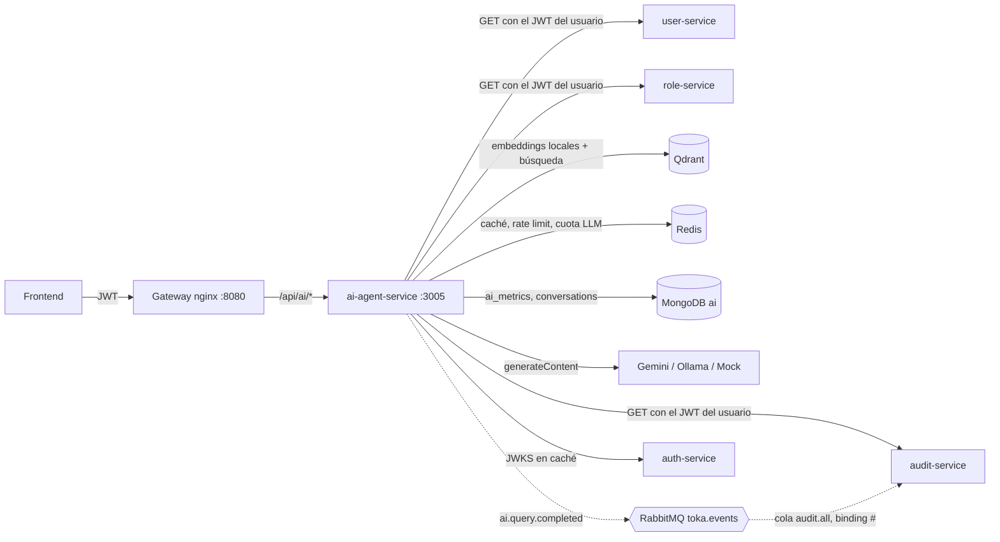
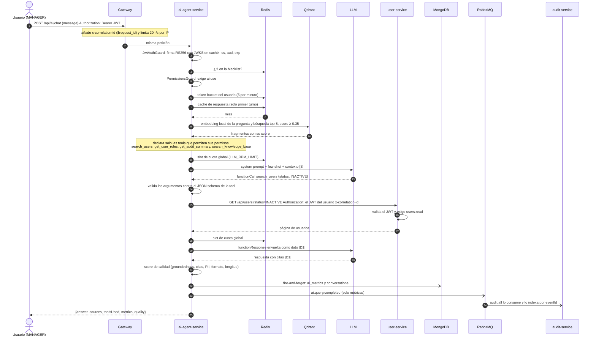

# Integración del agente IA con los microservicios

Cómo encaja `ai-agent-service` (puerto 3005) en el sistema existente. El diseño del agente (prompt, RAG, evaluación) está en [05-prompt-engineering.md](05-prompt-engineering.md) y las respuestas reales en [05-ejemplos.md](05-ejemplos.md).

## 1. Principio: el agente es un cliente más, con los permisos de quien pregunta

El agente **no tiene credenciales propias** sobre user, role ni audit-service. Cada herramienta llama al endpoint público de esos servicios con el `Authorization` del usuario que hizo la pregunta. Los permisos los sigue decidiendo el servicio dueño del dato, no el agente ni el prompt.

Consecuencia de diseño: aunque un atacante logre que el modelo «obedezca» una instrucción inyectada, lo máximo que puede obtener es lo que ese usuario ya podría pedir por la interfaz. No existe un camino con más privilegios que explotar (problema del *confused deputy*).



Las líneas punteadas son asíncronas. El agente **no consume** ningún evento.

## 2. Secuencia de una consulta con llamada a herramienta

Caso real de [05-ejemplos.md](05-ejemplos.md): un `MANAGER` pregunta *«Muéstrame los usuarios inactivos»*.



Dos llamadas al LLM por pregunta con herramienta (pasos 11 y 17); una sola si el contexto RAG basta. El límite duro es 3 llamadas y 4 ejecuciones de tools por petición.

## 3. Propagación del JWT y de la correlación

| Qué viaja | De → a | Cómo |
|---|---|---|
| `Authorization: Bearer <JWT del usuario>` | cliente → agente → user/role/audit | El controller lo lee del header y lo pasa a cada tool; `ResilientHttpClient` lo reenvía tal cual. |
| `x-correlation-id` | nginx → agente → servicios → evento | nginx lo crea con `$request_id` si falta. `CorrelationIdMiddleware` lo guarda en `AsyncLocalStorage`; `ResilientHttpClient` lo reenvía y `createEnvelope` lo incluye en el evento. |
| `x-internal-key` | **nunca** | Los endpoints `/internal/*` ni siquiera son alcanzables desde el gateway (404), y las tools no los usan. |

Cómo se valida el token en cada salto:

- **Agente:** valida la firma con la llave pública de auth-service (`createRemoteJWKSet`, con caché), `iss=toka-auth`, `aud=toka-api`, `exp`, y que el `jti` no esté en la blacklist de Redis (logout).
- **Servicios destino:** repiten la misma validación y aplican sus propios permisos (`users:read`, `roles:read` o «el propio usuario», `audit:read`). El agente no confía en que su filtrado previo baste: lo usa solo para ahorrar tokens y llamadas.
- **Tools filtradas antes del modelo:** un `USER` solo recibe `search_knowledge_base` y `get_user_roles` (de sí mismo). Si pide los roles de otro sin `roles:read`, la tool responde `FORBIDDEN` sin salir del agente.

Con el token vencido a mitad de una consulta: cada tool call usa el mismo JWT que llegó con la petición; si caduca durante los ~25 s máximos de la consulta, el servicio destino responde 401, la tool lo traduce a `FORBIDDEN` y el modelo explica que no pudo consultar el dato. La siguiente petición del frontend ya trae un token renovado (refresh single-flight).

Trazabilidad de punta a punta: un mismo `correlationId` aparece en los logs de nginx, ai-agent, user-service, en el documento de `ai_metrics` y en el evento almacenado por audit-service.

## 4. Eventos que publica

| Evento | Productor | Consumidores | Cuándo |
|---|---|---|---|
| `ai.query.completed` | ai-agent-service | audit-service (`audit.all`, binding `#`) | Al terminar cada petición de chat, incluidas las servidas desde caché y las degradadas. |

Envelope estándar (`eventId`, `type`, `version`, `occurredAt`, `correlationId`, `source`, `actor`, `data`). `actor.userId` e `ip` identifican a quien preguntó. `data` lleva únicamente métricas:

```json
{
  "requestId": "…", "conversationId": "…",
  "provider": "gemini", "model": "gemini-2.5-flash-lite",
  "cached": false, "degraded": false,
  "latencyMs": 1840, "inputTokens": 3120, "outputTokens": 96, "costUsd": 0.000351,
  "toolsUsed": ["search_users"], "qualityScore": 0.94
}
```

**Nunca incluye el texto de la pregunta ni de la respuesta** (contrato: sin PII ni prompts en eventos ni logs). Un ejemplo real está en [05-ejemplos.md](05-ejemplos.md#evidencia-en-el-resto-del-sistema).

**Por qué sin outbox transaccional.** auth, user y role usan outbox porque escriben en Postgres y el evento debe nacer en la misma transacción que el cambio. El agente no tiene un cambio de estado de negocio que proteger: la fuente de verdad de las métricas es su propia colección `ai_metrics` en Mongo, y el evento es una notificación para auditoría. Se publica con confirmación del broker y un tope de 5 s; si falla, se registra en el log y la respuesta al usuario no se ve afectada. El coste aceptado: ante una caída de RabbitMQ en ese instante, audit-service pierde esa notificación (la métrica sí queda en Mongo).

## 5. Qué pasa si algo está caído

La regla general: **el agente degrada, no se cae.** Solo hay dos casos en los que responde con error, y ambos son explícitos.

| Dependencia caída | Comportamiento | Lo ve el usuario como |
|---|---|---|
| **user / role / audit-service** (o breaker abierto) | `ResilientHttpClient`: timeout 2 s, hasta 2 reintentos con backoff (son GET) y breaker por servicio. La tool devuelve `UNAVAILABLE` y el modelo lo explica; no inventa datos (regla 10 del prompt). | Respuesta normal que dice que no pudo consultar ese dato y sugiere reintentar. Las preguntas de documentación siguen funcionando. |
| **Servicio destino responde 403** | La tool devuelve `FORBIDDEN`. | Negativa con el permiso que falta y cómo pedirlo. |
| **Gemini con 429, 5xx o timeout** | Reintento con backoff (respeta el `retryDelay` que anuncia Gemini), cada intento consume un slot de cuota global. Si se agota: siguiente proveedor de `LLM_FALLBACK_PROVIDER` (p. ej. Ollama) y, si no hay, **modo degradado**. | Respuesta con los fragmentos de documentación más relevantes y sus citas, marcada `quality.checks.degraded = true`. |
| **Modo degradado no aplicable** (ya se consultaron datos, o ningún fragmento supera 0,45) | No se inventa una respuesta. | **503** con `Retry-After`. |
| **Breaker de Gemini abierto** | Falla rápido sin llamar al proveedor (30 s de reset), con la misma cadena de fallback. | Igual que arriba. |
| **Cuota global de RPM agotada** | Espera hasta 8 s por un slot; si no llega, pasa al fallback. | Igual que arriba. |
| **Qdrant o el modelo de embeddings** | La recuperación es opcional: se registra y se sigue sin contexto RAG. `/health` informa `qdrant: down`. | Las preguntas de datos funcionan; las de documentación responden «no tengo información». |
| **Redis** | Si falla una operación puntual, la caché de respuestas, la de embeddings y el rate limit fallan abiertos (se registra y se sigue; el gateway sigue limitando por IP). Pero si Redis está caído de forma sostenida, el verificador de JWT no puede consultar la blacklist de `jti` y **falla cerrado**: toda petición autenticada recibe 401, igual que en los demás servicios. | Con un fallo puntual, sin diferencia visible (más latencia y coste). Con Redis caído, 401. |
| **MongoDB** | Métricas, guardado de la conversación y lectura de una conversación existente fallan abiertos: la respuesta sale. Una conversación que no se puede leer empieza de nuevo. | La respuesta, sin memoria del historial. `/api/ai/metrics` devuelve error. |
| **RabbitMQ** | `ai.query.completed` se pierde (ver §4). | Sin diferencia. |
| **auth-service** | Los tokens ya emitidos se siguen validando con el JWKS en caché. No se pueden emitir tokens nuevos. | Nada hasta que el JWT expire. |
| **Ingesta de la base de conocimiento** | Se ejecuta en segundo plano al arrancar (hasta 5 intentos cada 15 s). El servicio ya acepta peticiones mientras indexa. | Respuestas sin contexto de documentos hasta que termine (segundos). |

Los dos errores explícitos: **429** con `Retry-After` cuando el usuario supera 5 preguntas por minuto, y **503** cuando no hay modelo disponible y tampoco algo honesto que mostrar.

## 6. Cómo probarlo

```bash
docker compose up -d --build
TOKEN=$(curl -s -X POST localhost:8080/api/auth/login -H 'Content-Type: application/json' \
  -d '{"email":"admin@toka.local","password":"Admin123!"}' | jq -r .accessToken)

curl -s -X POST localhost:8080/api/ai/chat -H "Authorization: Bearer $TOKEN" \
  -H 'Content-Type: application/json' -d '{"message":"Dame un resumen de auditoría de hoy"}' | jq

# Reindexar la base de conocimiento (solo ADMIN) y ver métricas agregadas
curl -s -X POST localhost:8080/api/ai/ingest -H "Authorization: Bearer $TOKEN" | jq
curl -s localhost:8080/api/ai/metrics -H "Authorization: Bearer $TOKEN" | jq
```

Para ver la degradación: parar un servicio (`docker compose stop user-service`) y preguntar «Muéstrame los usuarios inactivos» como MANAGER; la respuesta explica que no pudo consultar el dato en vez de fallar.

Evaluación automática contra el stack levantado: `npm run eval:agent -w services/ai-agent-service` (16 casos: políticas, datos con tools, permisos e inyección de prompt) y `npm run eval:retrieval -w services/ai-agent-service` (calibración del RAG, sin LLM).
